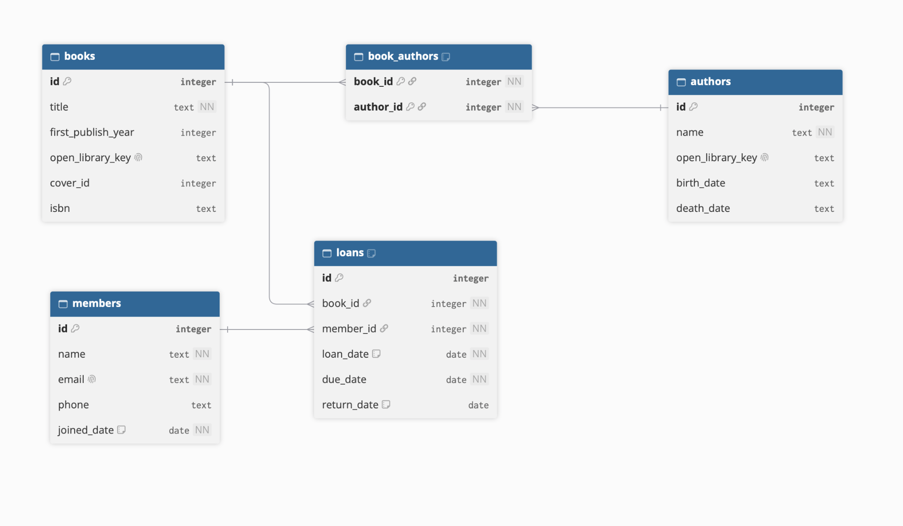

<h1>Contribution<h1>
<h2>Structure<h2>

  

      

<h2>Definition of Done:

* Each user story's acceptance criteria are met
* Follows our coding standard in CONTRIBUTING.md
* Main branch should be working without errors
* Each end point should be tested so it works in /docs, and in client.py if the client uses it
* Code complete and merged to main via pull request
* Each PR is peer-reviewed and approved by at least 1 teammate
* For each story create its own branch
* Merged to main, and main still runs
* No keys or passwords in the code

<h2>Expected coding standards:<h2>

<h3>Naming conventions <h3>

* Names need to be discriptive!!!
* Variables and Functions: Use snake_case (e.g., book_title, get_all_users()).
* Classes and Models: Use PascalCase (e.g., BookModel, DatabaseConnection).
* Files and Modules: Use snake_case (e.g., external_api.py, models.py).
* Constants: Use UPPER_SNAKE_CASE for fixed values (e.g., API_URL = "...").
* API Endpoints: Use plural nouns and lowercase letters (e.g., GET /books, POST /members).

<h3>PEP 8 and Formatting <h3>

* Indentation: Use exactly 4 spaces per indentation level. Never use tabs.
* Line Length: Keep lines to a maximum of 88 characters (this makes side-by-side reviews easier).
* Blank Lines:
    * Surround top-level functions and classes with two blank lines.
    * Surround methods inside a class with one blank line.
    * Imports: Group imports at the top of the file in this order:
    * Standard library imports (e.g., import os, import sqlite3)
    * Third-party imports (e.g., from fastapi import FastAPI, import requests)
    * Local application imports (e.g., from database import get_db)

<h3>Docstrings and Comments<h3>

* Docstrings: Write a brief docstring for every function, class, and module using triple double-quotes (""").
* Comments: Code should explain what is happening. Comments should explain why it is happening. Avoid obvious comments.

<h3>Branch naming convention<h3>

* Always branch off main. Name your branches using this format: <type>/<issue-number>-<short-description>.
    * Features: For building a new capability, user story, or API endpoint (e.g., feature/add-book-route).
    * Bug Fixes: For repairing broken code, solving merge conflicts, or patching an unexpected error (e.g.,bugfix/15-fix-database-crash)
    * Documentation: For updates strictly related to documentation, such as your README.md, CONTRIBUTING.md, or daily sprint notes (e.g., docs/update-er-diagram).
    * Refactor: For restructuring or improving existing code without changing its external behavior (e.g., refactor/clean-up-models).
    * Chore: For routine maintenance tasks, like updating requirements.txt or configuring the initial repository setup (e.g., chore/add-dotenv-package).

<h3>Reviewing process<h3>

* At least one other team member must read the code and approve the pull request before it can be merged.  
* Reviewers must explicitly state what works well in the code.   
* Reviewers must ask a relevant question or suggest an improvement.   
* Simply writing "LGTM" (Looks Good To Me) as the entire review is not permitted.   
* Reviewers should actively look for real problems or ways to improve the code design to reach a higher assessment level.  
* The original author of the pull request is responsible for fixing any issues raised in the review comments before executing the merge to the main branch.
* Every team member must complete a minimum of three code reviews over the course of the project.   

